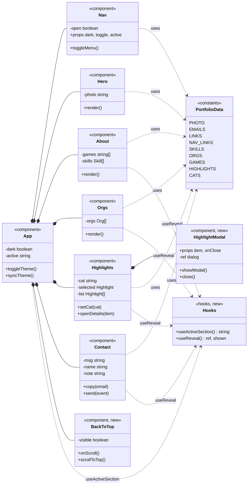

# Francis Benedict Gaviola | Portfolio

Personal portfolio website built with React, Vite and Tailwind CSS.

## Features

- Light and dark theme toggle that remembers your choice
- Responsive layout with a mobile hamburger menu
- Sticky nav bar that highlights the section you are viewing
- Highlights section with category filters and a details pop-up
- Contact section with copy buttons and a message form that opens a prefilled email
- Back-to-top button and fade-in animations on scroll (respects reduced motion)

## Tech stack

- React 19
- Vite
- Tailwind CSS v3 (with PostCSS and Autoprefixer)

## Run it locally

```bash
npm install
npm run dev
```

To make a production build:

```bash
npm run build
```

## Class diagram

Components marked "new" were added in the second activity.

